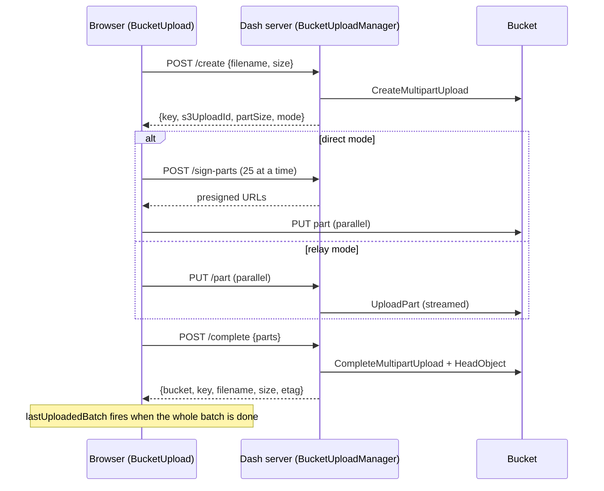

# How it works

## Upload lifecycle



1. **Create.** The server validates the request against the config, generates
   the key, starts a multipart upload, and picks the part size.
2. **Upload parts.** The browser slices the file with `Blob.slice`, which reads
   from disk on demand, so browser memory stays flat for any file size. Parts
   upload in parallel (4 per file, 6 across all files by default), each with
   retries.
3. **Complete.** The server completes the multipart upload, then reads the
   final size from the bucket instead of trusting the browser.
4. **Abort.** Cancelling, a failure, or unmounting the component aborts the
   multipart upload so its parts are discarded.

## Part sizing

S3 limits multipart uploads to 10,000 parts, each between 5 MiB (except the
last) and 5 GiB. The part size is chosen so a file fits in at most 9,500 parts,
leaving headroom for rounding:

```text
part_size = clamp(ceil(file_size / 9500) rounded up to a whole MiB, 16 MiB, 5 GiB)
```

| File size | Part size | Parts |
|---|---|---|
| 10 MB | 16 MiB | 1 |
| 1 GiB | 16 MiB | 64 |
| 100 GiB | 16 MiB | 6,400 |
| 500 GiB | 54 MiB | ≈ 9,482 |
| 5 TiB (S3 maximum object size) | 552 MiB | ≈ 9,498 |

`part_size=` on a config fixes the size instead. It must be at least 5 MiB, and
`file_size / part_size` must stay under 10,000.

## Stateless routes

The server stores nothing about an upload between requests. Instead, every
request after `/create` carries the config name, the object key and the S3
upload ID, and the server checks that the key matches the config's
`<prefix>/<uuid4>/<filename>` pattern. A client therefore can't touch objects
outside its config's prefix, and any worker or replica can serve any request.
With a `prefix_resolver`, the pattern uses the prefix resolved for the
requesting caller, so the check also keeps callers out of each other's uploads.

This is why a custom `key_generator` must keep the default key shape, and why
every process must register the same configs.

## Relay streaming

The `/part` route reads the request body in 1 MiB chunks into a spooled
temporary file that stays in memory up to 8 MiB and moves to disk beyond that.
boto3 needs a seekable body of known length to sign the `UploadPart` request,
so the part is fully received before it's forwarded. Server memory per
in-flight part is bounded at about 8 MiB, whatever the part size.

## Assets

The compiled JavaScript bundle ships inside the wheel and is served by Dash
from the package. There are no CSS files (the UI uses inline styles) and no
external requests, so the component works on air-gapped networks.
